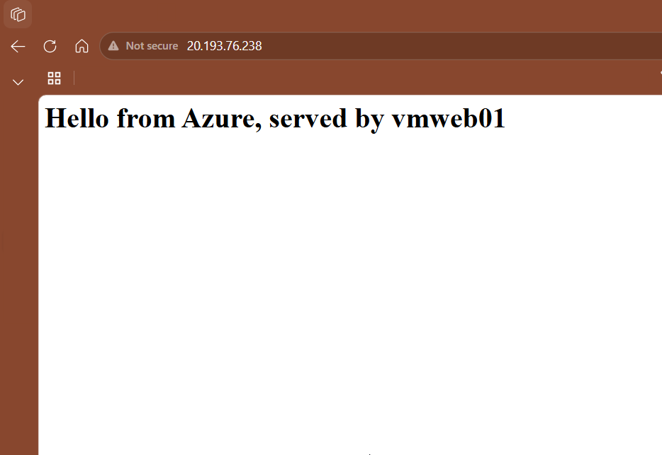

# Azure Load Balanced Web Server with Terraform

A small Terraform project that deploys an Ubuntu VM running Nginx behind an Azure Standard Load Balancer. Once it is up, the public IP serves a simple page showing the hostname of the VM that handled the request.

## Result



The page is served by Nginx on `vmweb01` and reached through the load balancer's public IP.

## Architecture

```
Internet
   |
   v
Public IP (Static, Standard SKU)
   |
   v
Azure Load Balancer (Standard)
   |  rule: TCP 80 to 80, HTTP probe on /
   v
Backend pool
   |
   v
NIC (nicweb01) in subnetweb (10.0.1.0/24)
   |
   v
Ubuntu 22.04 VM (vmweb01) running Nginx
```

## Resources created

| Resource | Name | Purpose |
|---|---|---|
| Resource group | from `var.resource_group_name` | Holds everything |
| Virtual network | `vnetweblab` | Address space `10.0.0.0/16` |
| Subnet | `subnetweb` | `10.0.1.0/24` |
| Network security group | `nsgweb` | Allows inbound HTTP (port 80) from the Internet |
| NSG association | n/a | Attaches the NSG to the subnet |
| Public IP | `pipweblb` | Static, Standard SKU, used by the load balancer frontend |
| Load balancer | `lbweb` | Standard SKU with a single frontend |
| Backend pool | `backendpool` | Targets the VM's NIC |
| Health probe | `http-running-probe` | HTTP check on port 80, path `/` |
| Load balancing rule | `rulehttp` | Forwards TCP 80 to port 80 on the backend |
| Network interface | `nicweb01` | Private IP, dynamic allocation, joined to the backend pool |
| Linux VM | `vmweb01` | Ubuntu 22.04 LTS, size `Standard_B2s` |

## How the web page gets there

The VM is configured at first boot with cloud init (`custom_data`). It:

1. Updates and upgrades packages
2. Installs Nginx
3. Writes an `index.html` that shows `Hello from Azure, served by <hostname>`

No manual setup on the VM is needed.

## Prerequisites

* [Terraform](https://developer.hashicorp.com/terraform/install) installed
* [Azure CLI](https://learn.microsoft.com/cli/azure/install-azure-cli) installed
* An Azure subscription you can create resources in

Log in before running Terraform:

```bash
az login
az account set --subscription "<your subscription id>"
```

## Variables

Set these in `terraform.tfvars` (or pass them on the command line).

| Variable | Description |
|---|---|
| `resource_group_name` | Name of the resource group to create |
| `location` | Azure region, for example `australiaeast` |
| `admin_username` | Admin username for the VM |
| `admin_password` | Admin password for the VM (use a strong one) |

Example `terraform.tfvars`:

```hcl
resource_group_name = "rg-weblab"
location            = "australiaeast"
admin_username      = "azureuser"
admin_password      = "<your strong password>"
```

## Usage

```bash
# Initialise providers and modules
terraform init

# Preview what will be created
terraform plan

# Deploy
terraform apply
```

When the apply finishes, Terraform prints the site URL:

```
site_url = "http://<public ip>"
```

Give the VM a minute or two after the apply completes so cloud init can finish installing Nginx, then open the URL in a browser. You should see the page shown in the screenshot above.

You can also test from the terminal:

```bash
curl $(terraform output -raw site_url)
```

## Clean up

The Standard Load Balancer, Static public IP and VM all cost money while they exist. Tear everything down when you are done:

```bash
terraform destroy
```

## Notes and possible improvements

* **Secrets:** `terraform.tfvars` contains the admin password, so keep it out of source control by adding it to `.gitignore`. The same goes for `terraform.tfstate` and its backup, which can also contain sensitive values. Marking `admin_password` as `sensitive = true` in `variables.tf` keeps it out of plan output.
* **Authentication:** The VM uses password authentication. SSH key authentication is safer for anything beyond a lab.
* **Access:** The NSG only allows port 80. There is no SSH rule, so you cannot log in to the VM from the Internet as it stands.
* **Single VM:** The page shows the hostname so it is easy to see which backend answered. With one VM it will always show `vmweb01`. Adding more VMs to the backend pool (or using a VM scale set) would show the load balancer spreading requests.
* **HTTPS:** Only HTTP is configured. Adding TLS would need something like Application Gateway or Front Door.
